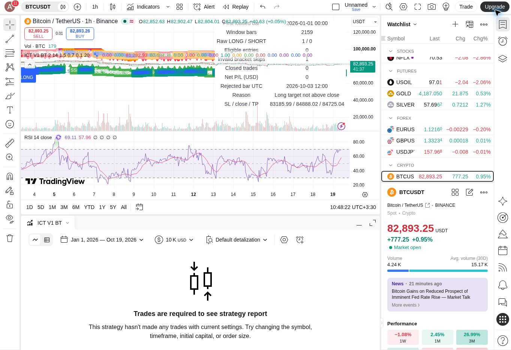

# BTCUSDT 1h — initial V1 research backtest

Run date: 2026-10-19, Asia/Tehran. Engine: TradingView Strategy Tester, standard BINANCE:BTCUSDT 1-hour candles.

## Result

**Zero trades. This run cannot estimate profitability, win rate or profit factor.**

| Measurement | Observed value |
| --- | ---: |
| Entry window start, UTC | 2026-07-21 00:00 |
| Entry window end, UTC | 2026-10-19 00:00 |
| First loaded bar, UTC | 2026-01-01 00:00 |
| Signal-evaluation bars inside window | 2,159 |
| Raw LONG signals | 1 |
| Raw SHORT signals | 0 |
| Eligible entries | 0 |
| Invalid brackets rejected | 1 |
| Closed trades | 0 |
| Net P/L shown by wrapper | USD 0 (no trading activity) |
| Win rate / profit factor | Not defined |

The final boundary candle is excluded from entry submission, explaining 2,159 rather than 2,160 hourly evaluation bars in the 90-day window. Earlier loaded bars initialize V1 state. TradingView's report header shows the broader loaded date range; the code applies the narrower entry filter.

## Why no trade was opened

The only LONG occurred on the bar opening **2026-10-03 12:00 UTC** (confirmation at its 13:00 UTC close):

- Signal close: **84,888.02**
- Proposed stop: **83,185.99**
- Proposed liquidity target: **84,725.04**
- Reason: target was already **162.98 below the signal close**.

The wrapper deliberately skips a Long when its frozen opposing-liquidity target is at or below signal close. It did not replace that target with a favorable future pivot or tune parameters to force a trade. The count is not evidence that the detector never signaled; it produced one signal, which did not satisfy the execution bracket.

## Entry basis

The original detector requires Sweep, a later same-bar displacement/MSS/FVG event, a later FVG retracement, a confirmed micro pivot formed after retracement, and a confirmed close beyond that micro pivot. A LONG/SHORT marker is the event. The research wrapper submits an entry only when flat and the signal-time stop/target are valid; the order is simulated on the next available tick, normally the next bar open. Touching the FVG alone is not an entry.

## Assumptions and verification

See [protocol](backtest-protocol.md). Initial simulated capital USD 10,000; 10% equity notional per order; assumed 0.1% commission per side; 10 minimum ticks slippage. No real trading, no broker connection, no publication. Original detector source is unchanged in its own file.

The research wrapper compiled and ran in TradingView, including raw-signal/invalid-bracket diagnostics, and was saved privately as **ICT V1 Research Backtest**. The indicator detector baseline is commit 2911242ab01c0d8d89cd2a027d611d8a91467782 / source blob 2b07b212d86defb474dd902b52954260e1f32943. No parameters were optimized.

**Limits:** the zero-trade run exercises rejection and diagnostic paths, not the positive entry/fill/exit path. The wrapper remains experimental and is submitted as a draft. The 24 detector behavioral acceptance cases, intrabar stop/target sequencing, independent non-repainting verification, and out-of-sample performance are still pending. Historical OHLC was not exported; reproduction depends on TradingView's current chart data.

Before a more useful performance test, define whether a setup with liquidity already behind price should be rejected, target an older unbroken liquidity level, or use a separately specified fixed-R exit. Those are different strategies and should not be silently substituted after seeing this result.
