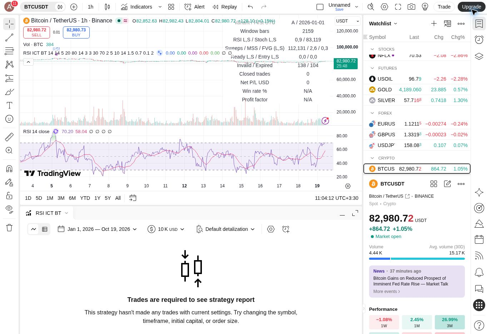
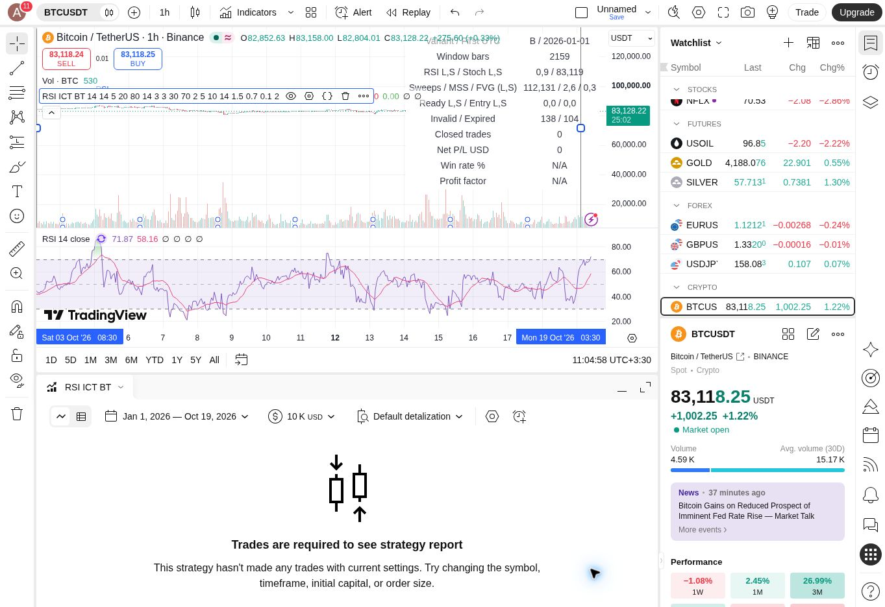

# RSI + ICT/FVG A/B — BTCUSDT 1h, 2026-10-19

## Scope
Two variants were compiled and run in TradingView, with both Long and Short enabled. Original V1 files are unchanged. See [protocol](rsi-ict-protocol.md) for all operational interpretations fixed before evaluation.

- Symbol: BINANCE:BTCUSDT, standard 1-hour candles.
- Entry window: 2026-07-21 00:00 UTC through 2026-10-19 00:00 UTC, excluding the final boundary candle from entry generation.
- First loaded bar: 2026-01-01; 2,159 signal-evaluation bars in the entry window.
- Initial equity USD10,000; 10% equity notional per trade; assumed commission 0.1% each side; slippage 10 minimum ticks.
- A: RSI + structure/FVG. B: same plus required Stochastic cross.
- Both: planned 2R target based on signal close; next-open execution means actual R may differ. No parameter optimization.

## Observed counts

| Metric | A | B |
| --- | ---: | ---: |
| Qualifying RSI triggers, Long / Short | 0 / 9 | 0 / 9 |
| Qualifying Stoch triggers, Long / Short (diagnostic even in A) | 83 / 119 | 83 / 119 |
| Setup-start sweeps, Long / Short | 112 / 131 | 112 / 131 |
| Displacement/MSS events in active setups, Long / Short | 2 / 6 | 2 / 6 |
| Associated FVG events in active setups, Long / Short | 0 / 3 | 0 / 3 |
| Fully ready setups, Long / Short | 0 / 0 | 0 / 0 |
| Submitted entries, Long / Short | 0 / 0 | 0 / 0 |
| Invalidated setups, both directions | 138 | 138 |
| Expired setups, both directions | 104 | 104 |
| Closed trades | 0 | 0 |
| Net P/L (no trading activity) | USD0 | USD0 |
| Win rate / profit factor | Undefined | Undefined |

A setup may remain pending at the boundary; counts of invalidated/expired events are not trade outcomes.

## Interpretation

Neither variant generated a trade. This is a measured zero-trade outcome, not an estimate of profitability or a zero-risk result.

No qualifying Long RSI crossover occurred with a below-20 reading in the current/previous-four-bar window. There were nine qualifying Short RSI events globally in-window, but none combined with the required structural/FVG conditions within the post-sweep confirmation deadline. Adding Stoch did not change the result because neither variant reached readiness.

This run does **not** establish that Stoch helps or hurts, nor that the user's overall idea is unprofitable. Results are conditional on the explicit pivot, displacement, FVG association, confirmation and first-retest definitions in the protocol. Do not loosen these definitions and present new numbers as the same test.

## Evidence

### A — no mandatory Stoch

### B — mandatory Stoch

## Validation and limits

Both versions compiled and executed without a surfaced compile/runtime error. The chart inputs confirmed RSI thresholds 20/80, Stoch thresholds 30/70, RSI/SMA periods 14/14, five-bar lookback, confirmation deadline 5, retest deadline 10, and planned reward/risk 2. Only the Stoch boolean changed between measured A and B.

The original V1 remains intact. The new strategy uses distinct direction-specific setup state and an explicit simultaneous-entry rejection policy. Runtime bracket guards reject invalid price ordering if reached.

Zero entries mean positive entry, fill, stop/target and simultaneous-candidate paths were NOT exercised by this market sample. This is an experimental implementation, not a fully accepted strategy. No independent synthetic acceptance suite, tick replay, exported raw OHLC reproduction, out-of-sample validation, or optimization was performed. Borrow/funding/spread/latency costs are not modeled; Shorts are hypothetical on spot OHLC. The strategy is saved privately; no real order or publication occurred.

## Next research decision
Keep this frozen baseline. For a separate predeclared test, first investigate oscillator timing (RSI crossover delay relative to the five-bar extreme window) and log each of the nine Short oscillator events against setup timing. Any longer RSI window, faster average, broader confirmation window or different FVG association is a NEW variant requiring its own comparison.
