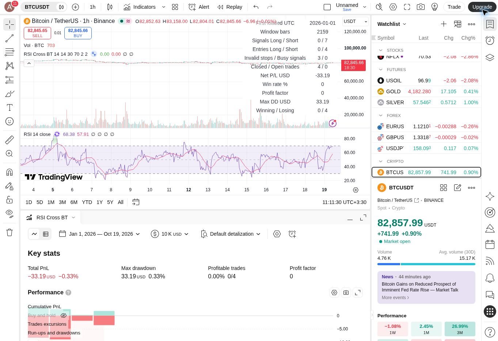

# Simple RSI/SMA 30–70 backtest — 2026-10-19

## Frozen rules

New variant requested after the zero-trade RSI+ICT experiments. **Entry signals use only RSI(14), its SMA(14), and the RSI value on the actual crossover candle:**
- LONG: confirmed crossover of RSI above its SMA, with RSI strictly below 30.
- SHORT: confirmed crossunder, with RSI strictly above 70.
- No ICT, FVG, sweep, Stoch or recent-five-bar extreme requirement in the signal.
- One position, no pyramiding or reversal; signals while in position are ignored.
- For research execution, use the latest prior-confirmed length-2 pivot low (Long) / pivot high (Short) plus one tick as fixed stop. A missing/wrong-side stop prevents an order; count it separately. Pivot is not a signal confirmation.
- Target is planned 2R from **signal close**, fixed at submission. Market execution at next available tick, normally next bar open, changes actual R through gaps/slippage.
- Standard BINANCE:BTCUSDT 1h candles; entry filter 2026-07-21 00:00 UTC to 2026-10-19 00:00 UTC, final boundary candle excluded to avoid entry beyond window. Force close at end boundary.
- USD10,000 initial equity, 10% equity **notional**, not 10% risk. Assumed commission 0.1% per fill and slippage 10 ticks. 100% margin, no leverage. No funding/borrow/spread/latency model.
- Ordinary TradingView OHLC emulator, no Bar Magnifier or tick/order-fill recalculation. Shorts are hypothetical on spot OHLC.
- No optimization or parameter changes after observing results.

These stop rules differ from the prior sweep-based stop because sweep is no longer required. This is not an isolated one-variable comparison with the earlier research strategies.

## Observed result

| Metric | Value |
| --- | ---: |
| First loaded bar UTC | 2026-01-01 |
| In-window entry-evaluation bars | 2,159 |
| Raw Long / Short signals | 0 / 7 |
| Submitted Long / Short entries | 0 / 4 |
| Missing/wrong-side stops skipped | 3 |
| Signals while busy | 0 |
| Closed / open trades after window | 4 / 0 |
| Winning / losing trades | 0 / 4 |
| Net P/L, including modeled costs | **-33.19 USD (-0.33%)** |
| Win rate | 0% |
| Profit factor | 0 |
| Maximum equity drawdown, TradingView | 33.19 USD (0.33%) |
| Average net result per trade, rounded | -8.30 USD |

## Visible trade list (manually transcribed)

Times below are converted to UTC from the UI's Asia/Tehran timestamps. Prices and per-trade P/L are displayed rounded values.

| # | Direction | Entry UTC | Entry USDT | Exit UTC | Exit USDT | Net USD |
| --- | --- | --- | ---: | --- | ---: | ---: |
| 1 | Short | 2026-08-20 03:00 | 69,301.17 | 2026-08-20 07:00 | 70,000.11 | -12.08 |
| 2 | Short | 2026-08-20 14:00 | 71,691.90 | 2026-08-20 15:00 | 72,490.11 | -13.11 |
| 3 | Short | 2026-08-20 19:00 | 72,431.25 | 2026-08-20 19:00 | 72,490.11 | -2.80 |
| 4 | Short | 2026-09-18 23:00 | 81,138.93 | 2026-09-19 00:00 | 81,400.11 | -5.20 |

Trade 3 entered and exited within the same hourly bar. This is an OHLC-emulator outcome, not an independently verified tick sequence. CSV download was attempted but TradingView displayed an upgrade requirement; no trial/purchase was initiated. The table is a visible-UI transcription, not a native export.

## Interpretation and validation

The strategy compiled and ran, with entry and exit paths exercised for four Short trades. The runtime diagnostics reconcile: 7 signals = 4 submitted entries + 3 skipped stops + 0 busy signals. The four displayed net P/L amounts sum to -33.19 USD, matching Strategy Tester. Long execution was not exercised.

The measured sample lost money under the stated execution model. Four trades, three concentrated on one day, cannot establish stable performance. There is no out-of-sample test, tick verification or independent raw-OHLC reproduction. Do not interpret the small account-level loss as a risk estimate: only 10% equity notional was allocated to each simulated position.

The simplified strategy is separate from the original V1 and the RSI+ICT A/B variants. It is saved privately as **RSI MA Cross 30-70 Research**; no live order or community publication.

Engine reference: https://www.tradingview.com/pine-script-docs/concepts/strategies/
