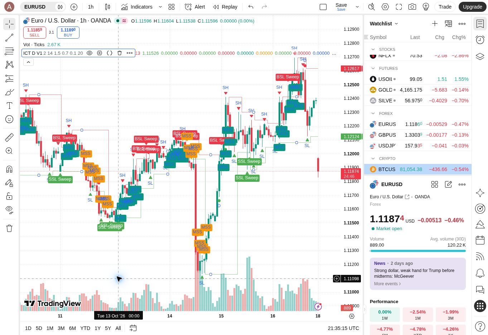

# TradingView V1 compilation and initial validation

Date: 2026-10-19 (Asia/Tehran).

## Version and environment

- Repository baseline: `2911242ab01c0d8d89cd2a027d611d8a91467782`.
- Source: `src/ict_detector_v1.pine`, blob `2b07b212d86defb474dd902b52954260e1f32943`.
- Pine Script v6, TradingView web Pine Editor; signed in to the user's account.
- Source pasted in full: 15,607 characters, 318 lines including final empty line. Editor select-all/copy was compared with the pasted source and matched exactly.
- Saved privately as **ICT Detector V1**. No community publication or trading action.

## Results

| Check | Result | Evidence / scope |
| --- | --- | --- |
| Compile and Add to chart | PASS | Original V1 added successfully; chart legend showed ICT D V1 and all six default parameters. No compile error was surfaced. |
| Save script | PASS | Editor title became ICT Detector V1; saved revision 1 was shown. |
| BATS:AAPL, 1D | PASS (smoke) | Indicator rendered swings, liquidity levels, sweep/MSS markers and a historical SHORT/Micro MSS label. No runtime error observed. This does not validate that signal's entire preceding sequence. |
| BINANCE:BTCUSDT, 1D | PASS (smoke) | Indicator recalculated, with BSL/SSL values in chart legend. |
| BINANCE:BTCUSDT, 15m | PASS (smoke) | Indicator and markers rendered after interval change; no runtime error observed. |
| OANDA:EURUSD, 1h | PASS (smoke) | Indicator and markers rendered after symbol/interval change; screenshot below. |
| Maximum Setup Bars 20 → 3 | PASS (input smoke) | Chart legend changed to 3 and calculation completed. Exact expiration-bar behavior was not verified. |
| Show MSS on → off | PASS (visual smoke) | MSS labels disappeared while other marker groups remained visible. |
| Restore defaults | PASS | Maximum Setup Bars restored to 20, Show MSS restored to on; final legend showed 2 / 14 / 1.5 / 0.7 / 0.1 / 20. |
| Intraday Bar Replay | BLOCKED | Selecting 2026-10-18 for BTCUSDT 15m opened TradingView's upgrade dialog: intraday replay requires an upgraded plan; account is Basic. Dialog dismissed without starting trial or purchase. |

**No compiler fix was necessary. The production Pine source is unchanged.**

## Limits and remaining acceptance tests

These are compilation, execution and visualization smoke tests, not completed behavioral acceptance or profitability tests. The 24 cases in `tests/test-cases.md` have not been systematically executed and must not be marked PASS from this report.

Still pending: exact full Long/Short sequence timing, missing-stage rejection, pivot availability delay, pre-retracement pivot rejection, directional state isolation, exact expiration/box endpoints, duplicate-signal rejection, realtime closed-bar retracement, and replay/realtime repainting verification. No live alert was created or delivered. Historical labels alone do not prove anti-repainting behavior.

All-layer visualization is dense: default MSS conditions mark each qualifying close beyond the stored swing, which can produce overlapping labels. Show MSS can be disabled for readability without changing the detection inputs.

## Reproduce

1. Open the source at the baseline commit in TradingView Pine Editor.
2. Add to chart and save privately.
3. Keep defaults: swing 2, ATR 14, displacement 1.5, body/range 0.70, minimum FVG 0.10 ATR, maximum setup bars 20.
4. Check AAPL 1D, BTCUSDT 1D/15m, EURUSD 1h.
5. Temporarily set maximum setup bars to 3 and disable Show MSS; check recalculation and display, then restore both.
6. For remaining behavioral tests, record the actual reference, confirmation and event bars; use an account with the needed intraday Replay entitlement, or validate suitable daily sequences separately.
